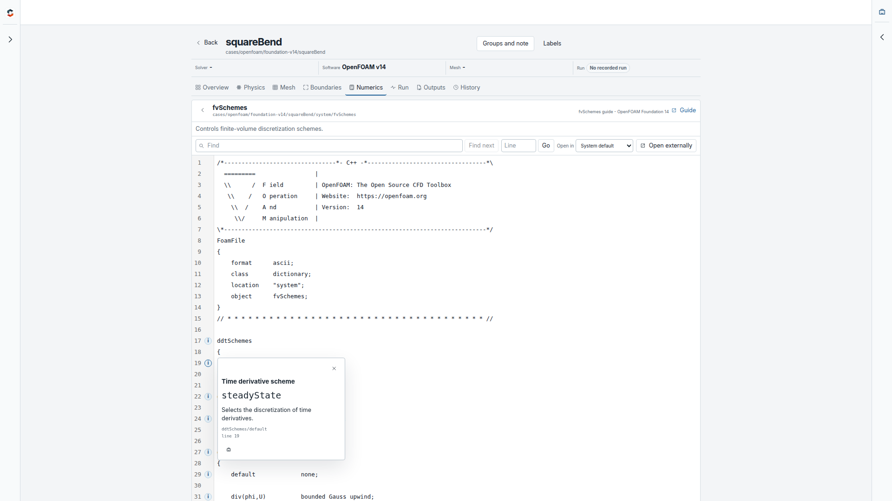
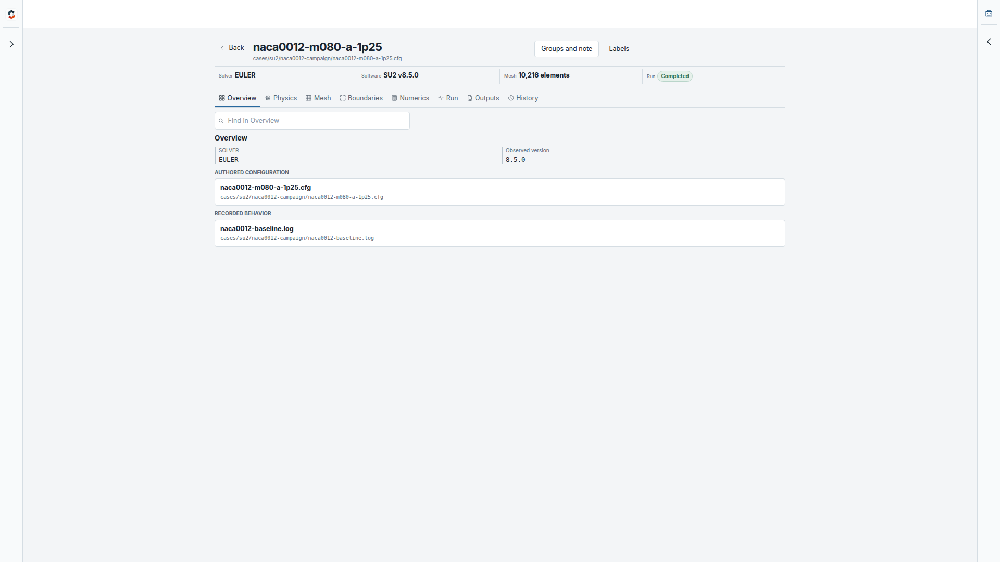
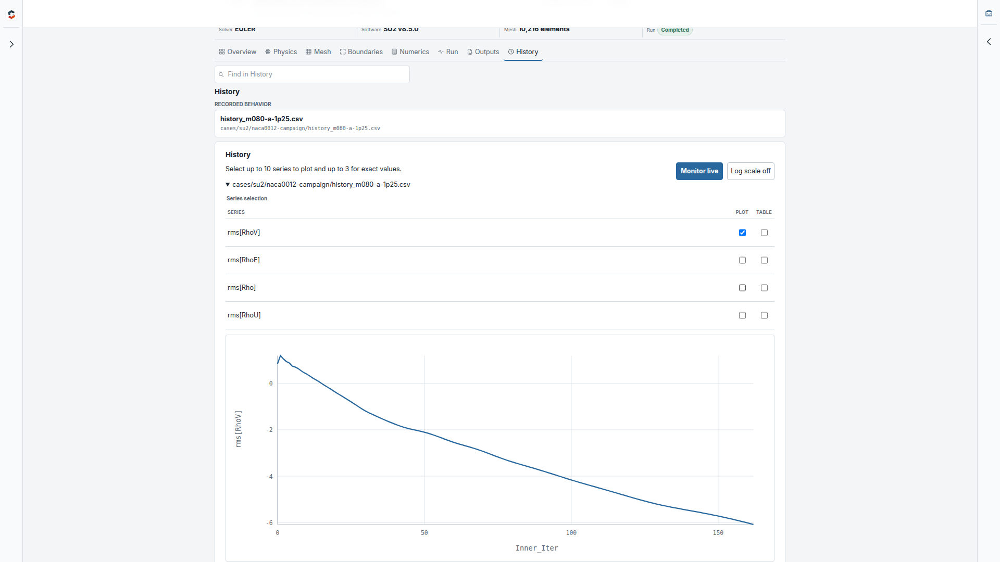
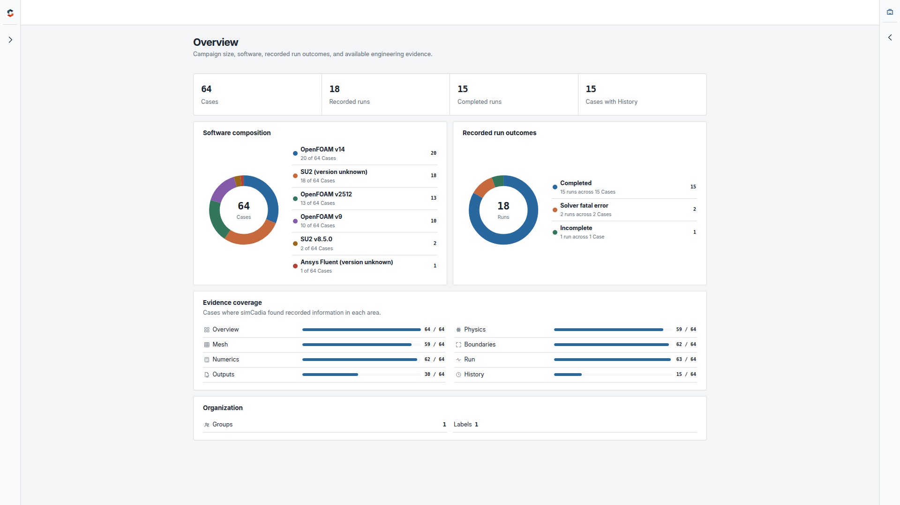
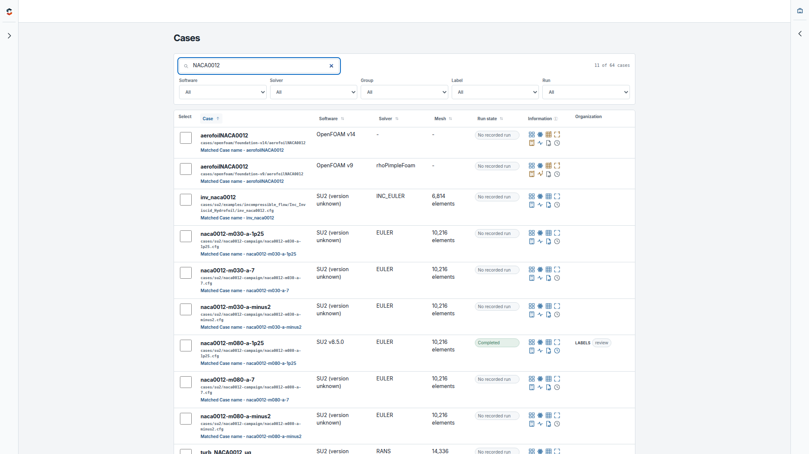
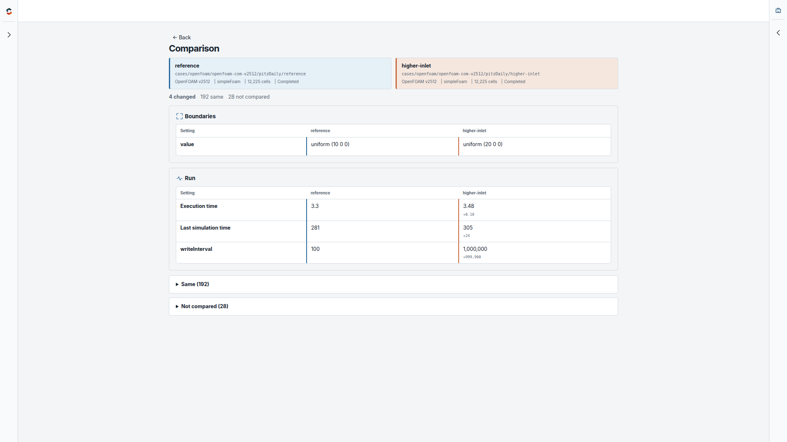
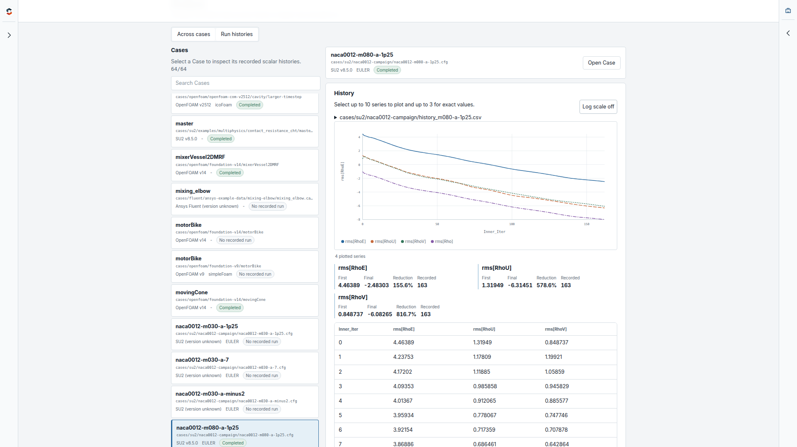
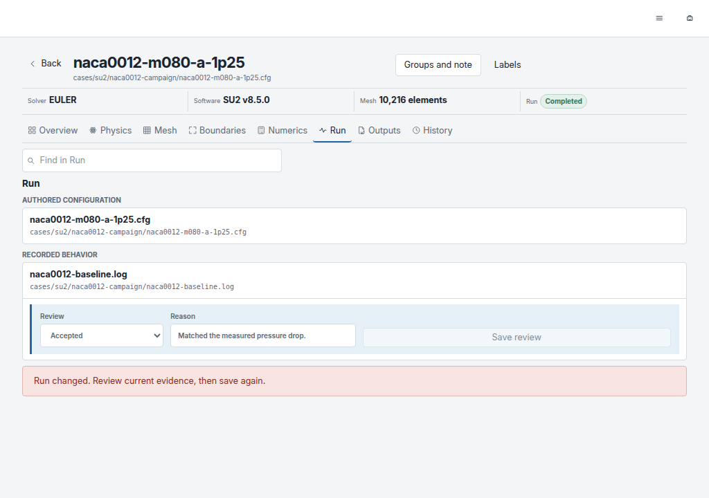
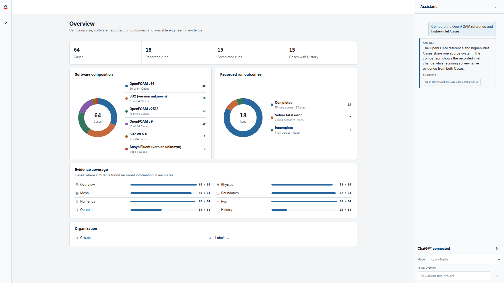
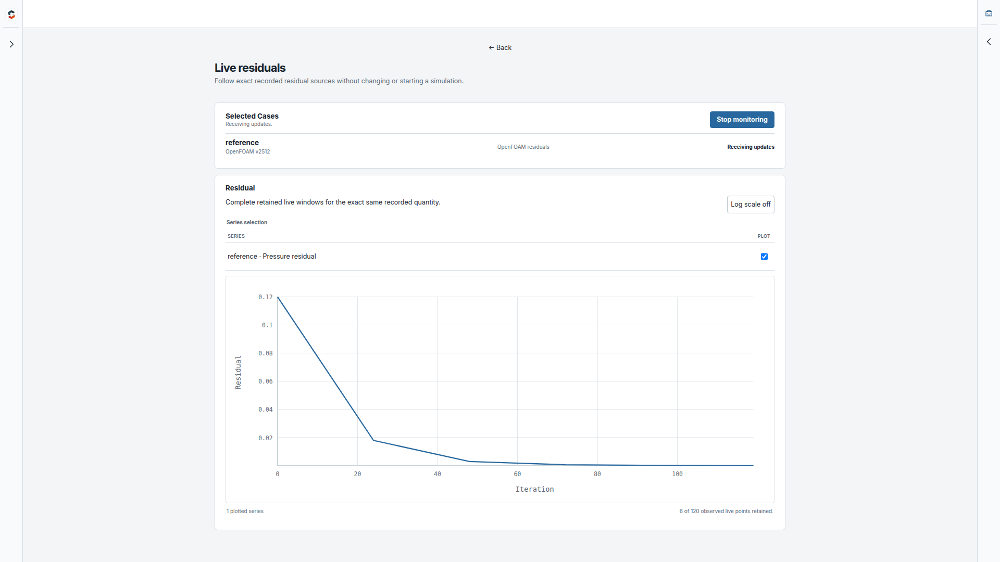

**simCadia 0.5: From extracted results to complete simulation context.**

Open complete OpenFOAM and SU2 source files inside simCadia, understand supported
settings directly beside the original text, and stay synchronized after external
edits.

OpenFOAM, SU2, and Ansys Fluent come together in one private, local engineering
workflow that keeps extracted insight connected to its source evidence.

## Download simCadia 0.5

| Platform       | Download                                                                                                                             | Start                                        |
| -------------- | ------------------------------------------------------------------------------------------------------------------------------------ | -------------------------------------------- |
| Windows 11 x64 | [`simCadia-0.5.0-win-x64.zip`](https://github.com/ru7herford/simcadia/releases/latest/download/simCadia-0.5.0-win-x64.zip)           | Extract the ZIP and run `simCadia.exe`.      |
| Linux x86-64   | [`simCadia-0.5.0-linux-x86_64.zip`](https://github.com/ru7herford/simcadia/releases/latest/download/simCadia-0.5.0-linux-x86_64.zip) | Extract the ZIP and run `./run-simcadia.sh`. |

Each download includes a 64-Case SampleProject spanning OpenFOAM, SU2, and
Fluent, ready to explore from the first launch.

## See the complete source in context

Open complete OpenFOAM and SU2 text files without losing comments, formatting,
or native terminology. Find text, jump to a line, open the same verified file in
an external editor, and inspect supported settings directly beside the source.

## Keep every Case connected to its files

Move through setup, physics, mesh, boundaries, numerics, run evidence, outputs,
and History using the native files that supplied the evidence. Saving a file in
an external editor triggers an automatic rescan and reloads the selected source
when it is still available.

## Inspect recorded History when you need it

Choose the series to plot, inspect exact values, page through long histories,
and move from recorded behavior back to the Case and source that produced it.

## See the whole campaign

Move from campaign scale and software composition to recorded outcomes and the
engineering evidence available across every Case.

## Find what matters

Navigate, search, filter, and sort simulation work by Case, source system,
solver, run state, recorded information, Group, or label.

## Compare simulations directly

See matching, differing, and unique evidence side by side while preserving the
language and structure of each solver.

## Reveal patterns across the work

Explore recorded values across many Cases, inspect their histories, and move
between campaign-level patterns and the simulations behind them.

## Review recorded runs

Bring solver progress, convergence, termination, and available outputs together
to capture a clear engineering judgment for each run.

## Ask questions grounded in evidence

The optional Assistant searches the project, summarizes the campaign, compares
Cases, inspects History, and connects its answers to the evidence simCadia has
established.

## Follow simulations in progress

Track recorded OpenFOAM and SU2 residual histories as they develop and keep live
behavior connected to the wider campaign.

## Build engineering context that lasts

Groups, labels, notes, reviews, and Assistant conversations keep the question,
evidence, and judgment around simulation work connected. Each investigation can
inform the next Case instead of ending as another isolated result.

If you work with CFD simulations, try simCadia and
[share what would make it more useful](https://github.com/ru7herford/simcadia/issues).
