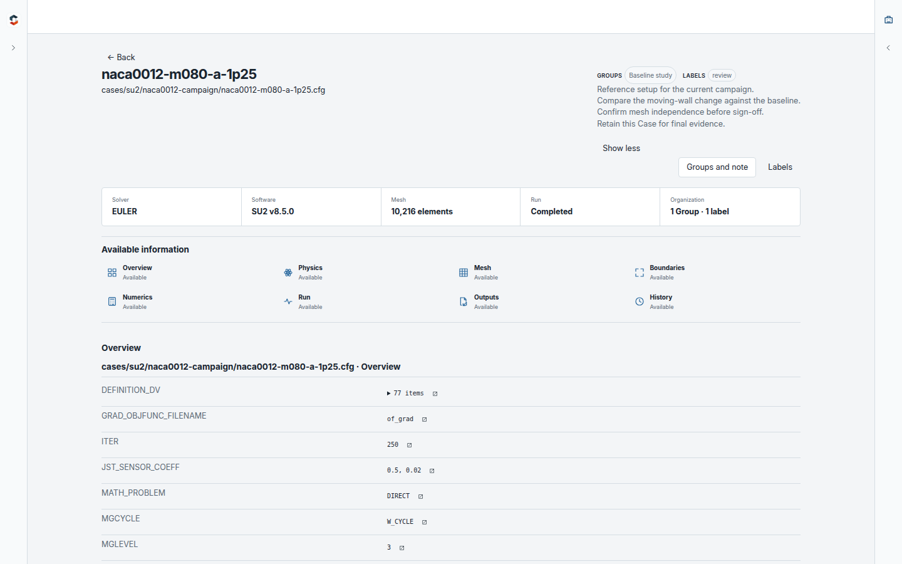
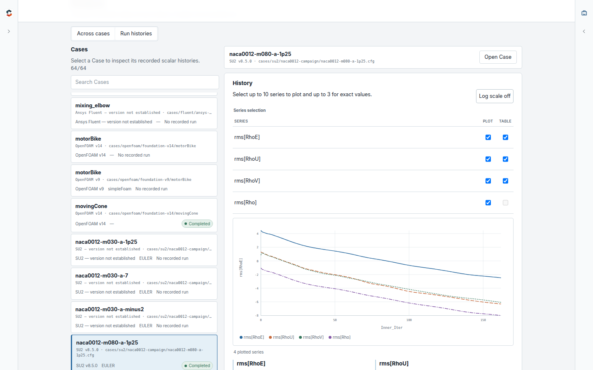

simCadia turns simulation evidence into engineering insight. Understand how
Cases were built, explore how they behaved, compare the results, and carry what
you learn into the next simulation.

OpenFOAM, SU2, and Ansys Fluent come together in one engineering workflow while
retaining the terminology and evidence that make each simulation meaningful.
Your simulation data stays private and on your machine.

## Download simCadia 0.4

| Platform       | Download                                                                                                                             | Start                                        |
| -------------- | ------------------------------------------------------------------------------------------------------------------------------------ | -------------------------------------------- |
| Windows 11 x64 | [`simCadia-0.4.0-win-x64.zip`](https://github.com/ru7herford/simcadia/releases/latest/download/simCadia-0.4.0-win-x64.zip)           | Extract the ZIP and run `simCadia.exe`.      |
| Linux x86-64   | [`simCadia-0.4.0-linux-x86_64.zip`](https://github.com/ru7herford/simcadia/releases/latest/download/simCadia-0.4.0-linux-x86_64.zip) | Extract the ZIP and run `./run-simcadia.sh`. |

Each download includes a 64-Case SampleProject spanning OpenFOAM, SU2, and
Fluent, ready to explore from the first launch.

## See the whole campaign

Move from campaign scale and software composition to recorded outcomes and the
engineering evidence available across every Case.

## Find what matters

Navigate, search, filter, and sort simulation work by Case, source system,
solver, run state, recorded information, Group, or label.

## Explore every Case

Bring setup, physics, mesh, boundaries, numerics, run evidence, outputs, and
History into one connected view with a clear path back to the source.

## Compare simulations directly

See matching, differing, and unique evidence side by side while preserving the
language and structure of each solver.

## Reveal patterns across the work

Explore recorded values across many Cases, inspect their histories, and move
between campaign-level patterns and the simulations behind them.

## Review recorded runs

Bring solver progress, convergence, termination, and available outputs together
to capture a clear engineering judgment for each run.

## Ask questions grounded in evidence

The optional Assistant searches the project, summarizes the campaign, compares
Cases, inspects History, and connects its answers to the evidence simCadia has
established.

## Follow simulations in progress

Track recorded OpenFOAM and SU2 residual histories as they develop and keep live
behavior connected to the wider campaign.

## Build engineering context that lasts

Groups, labels, notes, reviews, and Assistant conversations keep the question,
evidence, and judgment around simulation work connected. Each investigation can
inform the next Case instead of ending as another isolated result.

If you work with CFD simulations, try simCadia and
[share what would make it more useful](https://github.com/ru7herford/simcadia/issues).
